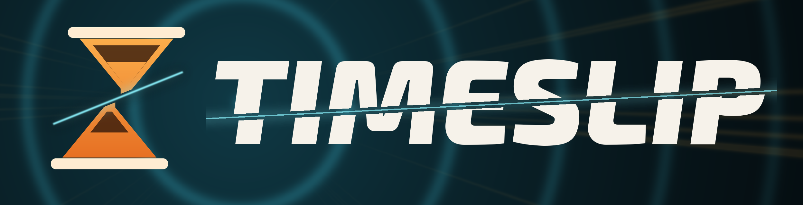
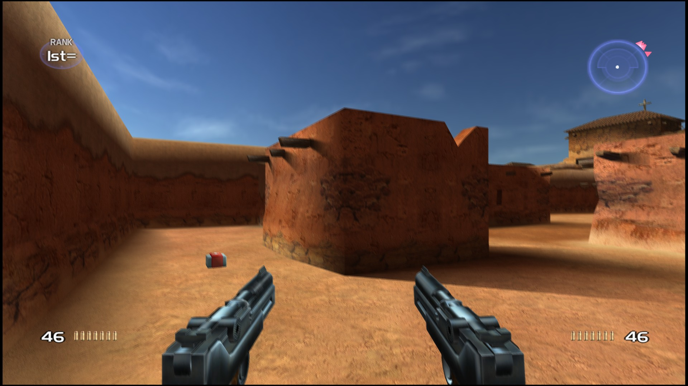
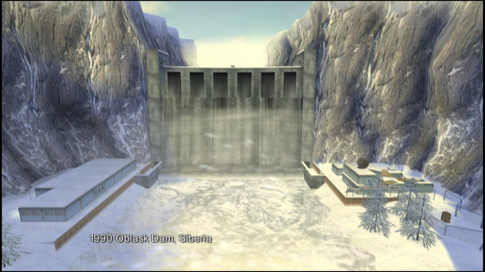
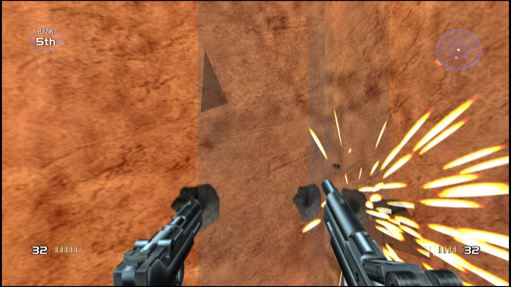
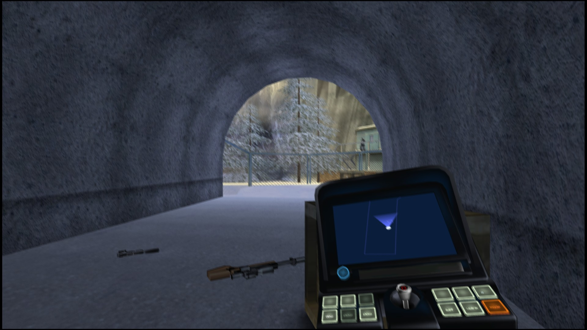
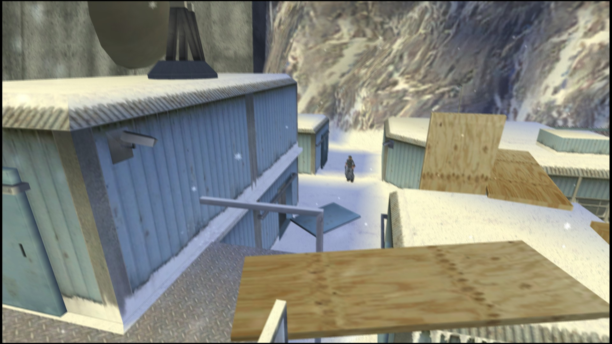
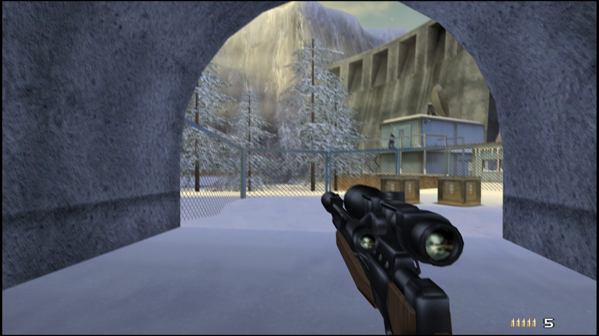
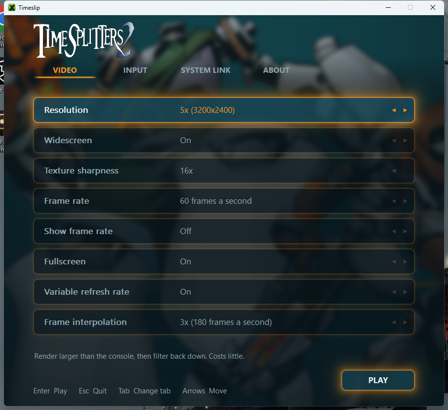
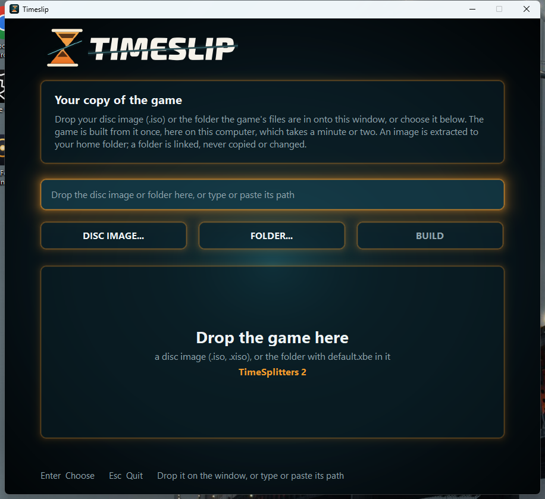

<p align="center"></p>

# Timeslip

TimeSplitters 2 for the original Xbox, recompiled into a native program for
Windows, macOS and Linux (including SteamOS and the Steam Deck). You bring your
own copy of the game, and it is built from that copy on your computer. This
repository and its releases contain no game code or data.

Timeslip is built on [Recompose](https://github.com/Joshspeakman/recompose),
its recompilation toolkit. Both began as forks of phobos665's work; see
[Credits](#credits).

<p align="center">






</p>

Rendered at 5 times the console's resolution in widescreen, captured from the
game as it runs (the two recordings in `tests/lockstep`).

<p align="center">


</p>

- [Play](#play): download, point it at your disc, play.
- [Build it yourself](#build-it-yourself): for developers working on the port.

# Play

## What you need

- TimeSplitters 2, PAL or USA: a disc image (`.iso` or `.xiso`) or a folder
  with the disc's files in it. Other releases are refused (see
  [Releases of the game](#releases-of-the-game)).
- 64-bit Windows 10 or 11, a Mac with Apple Silicon (macOS 13 or later), or
  x86-64 Linux, SteamOS included, with Vulkan drivers.
- About 450 MB of space, plus room for the game's files if you give it a disc
  image (an image is unpacked once; a folder is used where it is).

Nothing else needs installing: the download carries everything it builds the
game with.

## Download and start

Download the file for your system from the
[latest release](https://github.com/Joshspeakman/timeslip/releases/latest):

| System | File | Start |
| --- | --- | --- |
| Windows | `timeslip-<version>-windows-x86_64.zip` | Unzip it and run `timeslip.exe` |
| macOS | `timeslip-<version>-macos-arm64.tar.xz` | Unpack it, then see [macOS](#macos) below |
| Linux, SteamOS | `timeslip-<version>-linux-x86_64.tar.xz` | Unpack it and run `./timeslip` |

The first time it starts, it asks for your copy of the game: drop the disc
image or the game's folder onto its window (or onto its icon), choose **Disc
image...** or **Folder...**, or paste a path. It then builds the game, which
takes a minute or two (longer on a Steam Deck), and opens the settings. Press
**Play**. After that it opens straight to the settings.

**Windows** may say it protected your PC, because the release is not signed:
choose More info, then Run anyway.

### macOS

Move `TimeSplitters 2.app` to Applications. It is not signed with an Apple
Developer ID, so before opening it the first time, open Terminal and run

```sh
xattr -dr com.apple.quarantine "/Applications/TimeSplitters 2.app"
```

That clears the flag macOS puts on everything downloaded, from the app and the
tools it builds the game with. Then open it.

### Steam Deck and SteamOS

Unpack the release in desktop mode and run `timeslip` once to build the game.
To play from Game Mode, add `timeslip` to Steam (Add a Non-Steam Game) and give
the shortcut `icon.png` from the release folder as its icon.

## What works

- The front end, story mode and System Link deathmatch have been played.
  Challenge and MapMaker have had little testing.
- 60 fps, paced the way the console paced it.
- Widescreen. The camera is widened rather than stretched, and the menus and
  HUD are laid out for 16:9.
- Rendering at up to 8x the console's 640x480.
- Frame interpolation: 120 or more frames a second on screen while the game
  itself runs at 60.
- Fullscreen and variable refresh rate (G-SYNC, FreeSync).
- Controllers and keyboard, both rebindable.
- System Link on Windows, over a LAN or the internet; on macOS between copies on one Mac
  (between machines: not checked yet). Not on Linux yet.

## Controls

Controllers work as an Xbox pad. The keyboard and mouse play as controller 1,
laid out like a modern PC shooter:

| Action | Keyboard and mouse |
| --- | --- |
| Move, side step | W A S D |
| Look | The mouse |
| Fire | Left mouse button |
| Aim | Right mouse button |
| Alternate fire | G, middle mouse button |
| Reload | R |
| Use (activate) | F, E, Space |
| Crouch | C, left Ctrl |
| Next / previous weapon | Mouse wheel, Q, left and right arrows |
| Zoom in / out | Z / X, the mouse's side buttons, up and down arrows |
| Pause the game, objectives | Enter, Tab |
| Menus | W A S D or arrows to move, Enter, Space or F to choose, Backspace to go back; or the mouse: the pointer shows in the game's menus, the wheel moves, the left button chooses, the right goes back |

These are the game's own "Default" control configuration (Options > Player
Options > Controls); change the keys in the launcher's Controls.

While playing:

| Key | |
| --- | --- |
| Esc | The PC menu: pause, settings (display, frame rate, mouse) and Quit to desktop |
| F9 | Show or hide the frame rate |
| F10 | Change the frame cap: adaptive, 60, 30, off |
| F11 | Save a screenshot and a capture of the frame, for bug reports |
| Alt+Enter | Switch between fullscreen and a window |

## Settings

The launcher's two cards choose the renderer: Direct3D 11 (the default) or
Vulkan on Windows; the Mac draws with Metal. Its Graphics Options:

| Setting | What it does |
| --- | --- |
| Resolution | Renders at 1 to 8 times 640x480 and filters down. 2 is much sharper and costs little |
| Widescreen | 16:9, with the wider camera and menus |
| Texture sharpness | Anisotropic filtering, 1 to 16 |
| Frame rate | Adaptive (the default), 60, 30, or uncapped |
| Show frame rate | Start with the counter on |
| Fullscreen | Borderless fullscreen |
| Variable refresh rate | In fullscreen, an even 60 on a high refresh display. It has to be on in the display's driver too |
| Frame interpolation | 2 shows twice the game's frames, up to 4. 1 is off. Best with variable refresh |

The game runs its logic once a frame, so an uncapped frame rate makes it run
fast. Use frame interpolation for smoother motion instead.

To keep the front end at 4:3 between bars while the levels are 16:9, add
`ts2_menus = 43` to the settings file (see [Where things are
kept](#where-things-are-kept)).

## System Link

Windows, and macOS between copies on one Mac so far (see
[docs/multiplayer.md](docs/multiplayer.md)). On Linux it is not checked yet.

One player hosts a session and everyone else joins it. Up to 16 copies can be
in one session. In the launcher's Online:

- Host a session. The launcher shows the address to give the others: your PC's
  address on your own network, and your internet address once your router
  answers. With Open the router on (the default), the game asks your router
  (over UPnP) to forward UDP port 27610 while you host. If your router does not
  support UPnP, forward that port to your PC yourself.
- Join a session. Enter the host's address, with `:port` at the end if they do
  not use 27610. A joining player does not need to open anything.
- Join code. Optional. If the host sets one, only players who enter the same
  word can join.

Then everyone starts the game and opens System Link from its own menus, as on
a console. Any player can host the game there, not only the one who hosts the
session. The session ends when its host quits.

Copies of this port can play each other without anything else. To play
against xemu or a real console, you also need your console's `XboxLANKey` in
`%APPDATA%\xboxrecomp\keys.ini` as `lan_key = ...`. The details are in the
toolkit's
[system-link.md](https://github.com/Joshspeakman/recompose/blob/main/docs/technical/system-link.md).

## Where things are kept

The built game, its saves and the logs are in one folder per user:

| | |
| --- | --- |
| Windows | `%LOCALAPPDATA%\xboxrecomp\builds\4553000A\` |
| macOS | `~/Library/Application Support/xboxrecomp/builds/4553000A/` |
| Linux | `~/.local/share/xboxrecomp/builds/4553000A/` |

In it, `game/UDATA/4553000a/` holds your saves, `build.log` is the build's
log and `timeslip.log` the game's. Your own disc or folder is never
written to.

The settings and controls are kept apart from the build:

| | Settings | Controls |
| --- | --- | --- |
| Windows | `%APPDATA%\xboxrecomp\titles\4553000A.conf` | `%APPDATA%\xboxrecomp\input_bindings.json` |
| macOS | `~/Library/Application Support/xboxrecomp/titles/4553000A.conf` | `~/Library/Application Support/xboxrecomp/input_bindings.json` |
| Linux | `~/.config/xboxrecomp/titles/4553000A.conf` | `~/.config/xboxrecomp/input_bindings.json` |

## Updating

Download the new release and start it. It sees that the game was built by an
older release and offers **Build again**, with your disc remembered. Saves and
settings carry over.

## Problems

- The disc is refused: it is not one of the releases below. Please open an
  issue with the title, region and SHA-1 the message shows.
- The build fails: open an issue and attach `build.log` (see [Where things
  are kept](#where-things-are-kept)).
- A black window and nothing else: attach `timeslip.log` from the same
  folder.
- A rendering bug in one place: press F11 there, and attach the `.bmp` and
  `.d3dcap` files it writes beside the game.

## Releases of the game

The game is recognised by the SHA-1 of its `default.xbe`:

| Release | `default.xbe` SHA-1 |
| --- | --- |
| PAL | `2809eb147385723eaa90c425be89ee4db033fc5a` |
| USA (NTSC) | `3ec95fe3ae9e7794d83a5b489ad8583f352e0c18` |

Any other disc, such as the Japanese release or another revision, is refused.

# Build it yourself

For working on the port. This builds the same game by hand, from a clone,
against the [Recompose](https://github.com/Joshspeakman/recompose)
toolkit (`recompose/` here): the build translates the game's code to C, then
compiles it.

## What you need to build

TimeSplitters 2, PAL or USA, extracted from your disc. The build reads
`default.xbe` to tell which release it is, and stops if it is neither.

Windows 10 or 11, 64-bit:

- Visual Studio 2022 or 2019 with the Desktop development with C++ workload
- [CMake](https://cmake.org/download/) 3.20 or newer, on PATH
- Python 3.10 or newer with `capstone`: `py -3 -m pip install capstone`
- Git

macOS on Apple Silicon:

- Xcode's command line tools: `xcode-select --install`
- CMake, Ninja and OpenSSL from Homebrew: `brew install cmake ninja openssl@3`
- The [LunarG Vulkan SDK](https://vulkan.lunarg.com/sdk/home#mac), installed
  system-wide. It provides MoltenVK and the shader compiler.
- Python 3.10 or newer with `capstone`. Homebrew's Python will not install
  packages globally, so use a virtual environment:
  `python3 -m venv ~/.venvs/recomp && ~/.venvs/recomp/bin/pip install capstone`

Linux, x86-64:

- GCC or Clang, CMake 3.20 or newer, Ninja, pkg-config, Git, curl
- Development headers for X11 and Wayland, PulseAudio or PipeWire, OpenSSL,
  FreeType and fontconfig
- Vulkan drivers (Mesa's RADV, ANV, or NVIDIA's own)
- Python 3.10 or newer with `capstone`, in a virtual environment as on macOS:
  `python3 -m venv ~/.venvs/recomp && ~/.venvs/recomp/bin/pip install capstone`

On Debian or Ubuntu that is

```sh
sudo apt install build-essential cmake ninja-build pkg-config git curl python3-venv \
    libx11-dev libxext-dev libxrandr-dev libxcursor-dev libxi-dev libxss-dev \
    libxfixes-dev libxtst-dev libxkbcommon-dev libwayland-dev wayland-protocols \
    libegl-dev libdrm-dev libgbm-dev libpulse-dev libasound2-dev libudev-dev \
    libssl-dev libfreetype-dev libfontconfig-dev
```

SteamOS has no compiler, and its system is read-only, so build inside the
Freedesktop SDK, which runs as a Flatpak and has all of the above. It is
often installed already, because Flatpak apps such as VS Code use it; if
`flatpak list` does not show `org.freedesktop.Sdk` 25.08, install it with
`flatpak install flathub org.freedesktop.Sdk//25.08`. Open a shell in it from
Konsole:

```sh
flatpak run --filesystem=home --share=network --device=dri \
    --socket=wayland --socket=fallback-x11 --socket=pulseaudio \
    --command=bash org.freedesktop.Sdk//25.08
```

and do everything below in that shell, venv included. The game it builds also
runs outside it, straight from SteamOS.

## Build

```sh
git clone --recursive https://github.com/Joshspeakman/timeslip.git
cd timeslip
```

Copy the extracted disc into a folder called `game`, so that `game/default.xbe`
exists with `data/`, `music/` and the rest beside it.

On Linux, fetch the shader compiler first (once; distributions do not package
it):

```sh
bash recompose/tools/linux/fetch_dxc.sh
```

Then:

```sh
py -3 scripts/build.py                        # Windows
~/.venvs/recomp/bin/python scripts/build.py   # macOS and Linux
```

The first run translates the game, which takes a few minutes, then compiles
it, which takes longer. Later runs only recompile. The program ends up in
`build/Release/`:

| | Windows | macOS and Linux |
| --- | --- | --- |
| The game | `timeslip.exe` | `timeslip` |
| Settings window, then the game | `timeslip_launcher.exe` | `timeslip_launcher` |

If your extracted games live somewhere else, `game` can be a link to the folder
(`ln -s "/path/to/TimeSplitters 2" game`), or pass `--game DIR` to the build and
set `RECOMP_GAME_DIR` when you play.

If you cloned without `--recursive`, run `git submodule update --init --recursive`.

## Running a build of your own

The controls and settings are the ones in [Play](#play). Every setting is also
a line in the settings file and an environment variable, which wins over the
file:

| Setting | File | Environment |
| --- | --- | --- |
| Resolution | `resolution_scale` | `RECOMP_RES_SCALE` |
| Widescreen | `widescreen` | `RECOMP_WIDESCREEN` |
| Renderer | `renderer` (`auto`, `d3d11`, `vulkan`, `metal`) | `RECOMP_D3D8_BACKEND` |
| Texture sharpness | `anisotropy` | `RECOMP_ANISO` |
| Post-processing (the game's soften pass) | `post_soften` (`sharp`, `console`, `off`) | `RECOMP_POST_SOFTEN` |
| Leave out glows that would flash the whole screen | `reduce_flashes` (on unless `0`) | `RECOMP_REDUCE_FLASHES` |
| Frame rate | `frame_cap` (0 for uncapped) | `RECOMP_FPS_CAP` |
| Show frame rate | `fps_overlay` | `RECOMP_FPS_OVERLAY` |
| Fullscreen | `fullscreen` | `RECOMP_FULLSCREEN` |
| Variable refresh rate | `vrr` | `RECOMP_VRR` |
| Frame interpolation | `frame_interp` | `RECOMP_FRAME_INTERP` |
| 4:3 front end | `ts2_menus = 43` | `RECOMP_TS2_MENUS=43` |

The settings and controls files are as in [Where things are
kept](#where-things-are-kept);
the controls' format is in `recompose/docs/technical/input-binding.md`. What
differs from a release:

| | Windows | macOS and Linux |
| --- | --- | --- |
| Saves | `game\UDATA\4553000a\` | `game/UDATA/4553000a/` |
| Log, when not started from a terminal | `build\Release\timeslip.log` | `build/Release/timeslip.log` |

System Link without the launcher:

```text
host: RECOMP_SYSLINK=host [RECOMP_SYSLINK_PORT=27610] [RECOMP_SYSLINK_CODE=word]
join: RECOMP_SYSLINK=join RECOMP_SYSLINK_HOST=81.2.3.4[:port] [RECOMP_SYSLINK_CODE=word]
```

## Other releases of the game

Each release the build accepts has a folder of addresses inside its
`default.xbe`: function entry points, XDK functions and the places this
repository's fixes attach to.

| Release | Addresses |
| --- | --- |
| PAL | `config/pal/` |
| USA (NTSC) | `config/us/` |

Another disc needs a folder of its own. The build stops and prints the SHA-1;
please open an issue with it.

## Updating a clone

```sh
git pull
git submodule update --init --recursive
py -3 scripts/build.py --relift
```

On macOS and Linux, use `~/.venvs/recomp/bin/python` in place of `py -3`. `--relift`
translates the game again, which is needed whenever the toolkit or `config/`
changes.

## Making a release

Pushing a version tag (`git tag v1.0 && git push origin v1.0`) runs
`.github/workflows/release.yml`, which builds the Windows, macOS and Linux
downloads from `release/timeslip.json` and attaches them to the tag's GitHub
release. No game files are involved. How the downloads work is in the
toolkit's
[self-build-release.md](https://github.com/Joshspeakman/recompose/blob/main/docs/technical/self-build-release.md).

## Build problems

- "no default.xbe in ...": the disc's files are not in `game/`.
- Linux, "DXC (the shader compiler) is missing": run
  `bash recompose/tools/linux/fetch_dxc.sh`, then build again.

# Credits

Timeslip began as a fork of [split2-recomp](https://github.com/phobos665/split2-recomp)
by phobos665, and Recompose as a fork of
[DirectXbox-Recomp](https://github.com/phobos665/DirectXbox-Recomp) by
phobos665 and its contributors. Their history is kept in both repositories.
Since November 2026 the two are developed separately and nothing is sent
back upstream. Thank you to phobos665 and everyone who worked on the
originals; phobos665 can be supported on [Ko-fi](https://ko-fi.com/phobos665).

Timeslip's own icon, logo and box art (`art/`), for the app, its shortcuts
and this repository, are drawn by `tools/art/make_art.py` and set in
[Exo 2](https://github.com/googlefonts/Exo-2.0) (SIL Open Font License,
`tools/art/fonts/OFL.txt`).

The launcher shows the game's own logo and art, made from your own copy of
the game: `tools/make_disc_art.py` on Windows (the installer,
`tools/install_windows.ps1`, runs it once) and `mac/make_art.sh` on a Mac
play into the Siberia level and keep a few of its frames. None of the
game's art files are in this repository or its releases, and nothing is
downloaded unless you ask: `RECOMP_LAUNCHER_FETCH_ART=1` fetches the key art
and logo once from the [LaunchBox Games Database](https://gamesdb.launchbox-app.com/)
(`src/launcher_theme_timeslip.h`). Without either, the launcher writes the
game's name.

# Legal

TimeSplitters 2 is a trademark of its owners; Timeslip is not affiliated with
or endorsed by them. You need your own copy of the game. Do not share the
game's files, the built game, a clone's `src/recomp/` (it is the game's
translated code) or anything in `build/`. This repository, its releases and
Recompose contain no game code or assets.

The code in this repository is licensed under the GNU General Public License
v3.0, as the original was; see [LICENSE](LICENSE). That covers the files
committed here, not the game.
