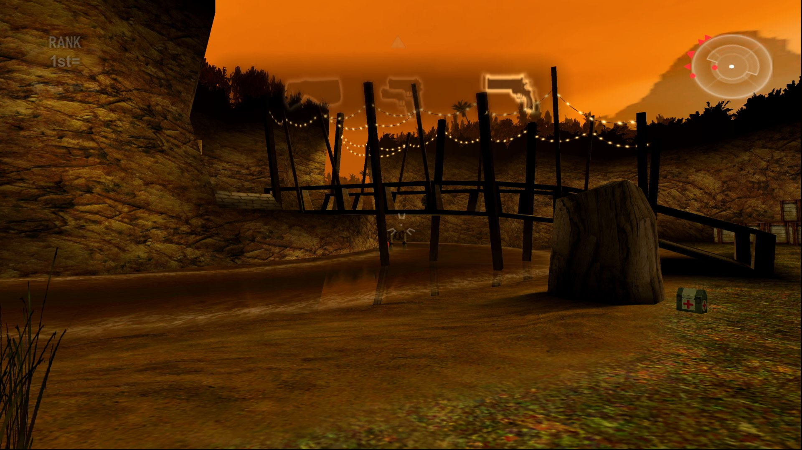
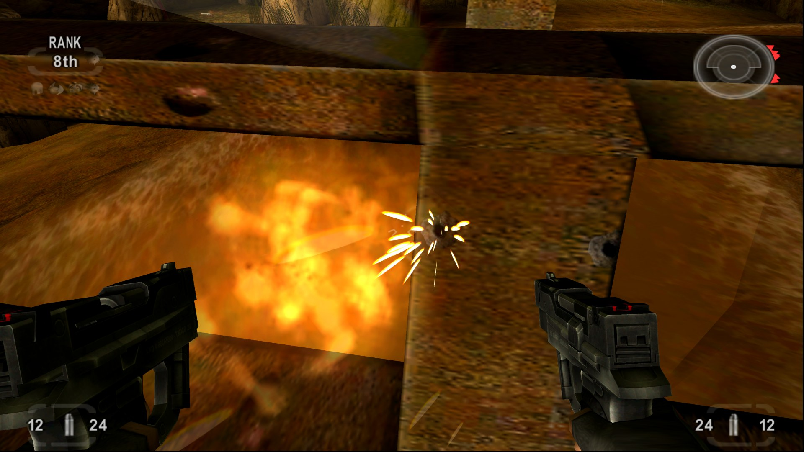
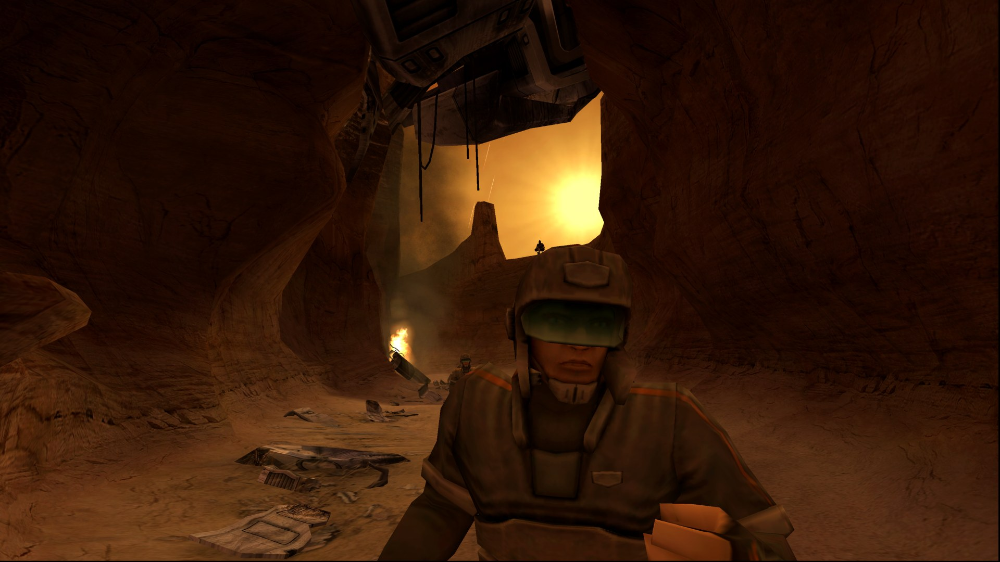
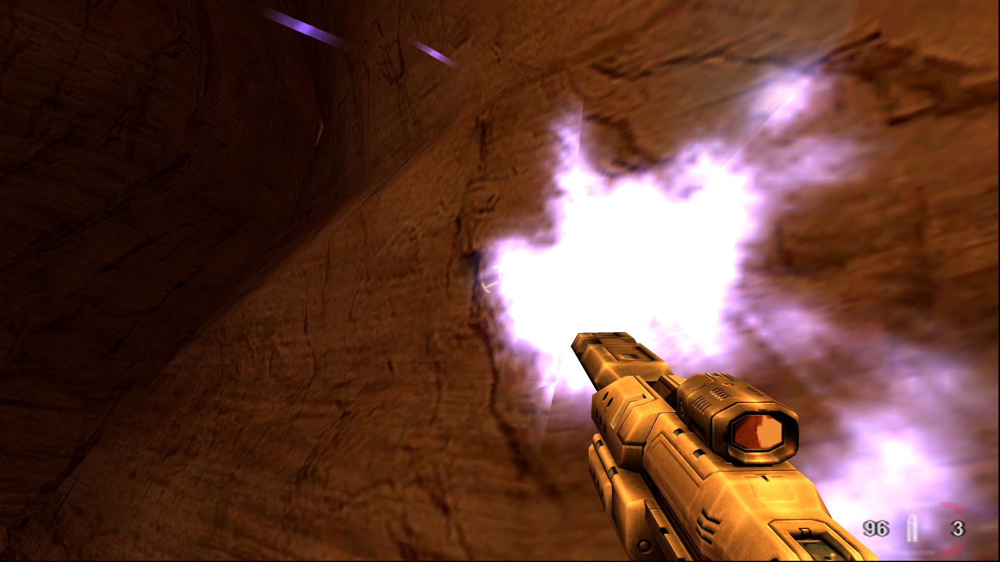
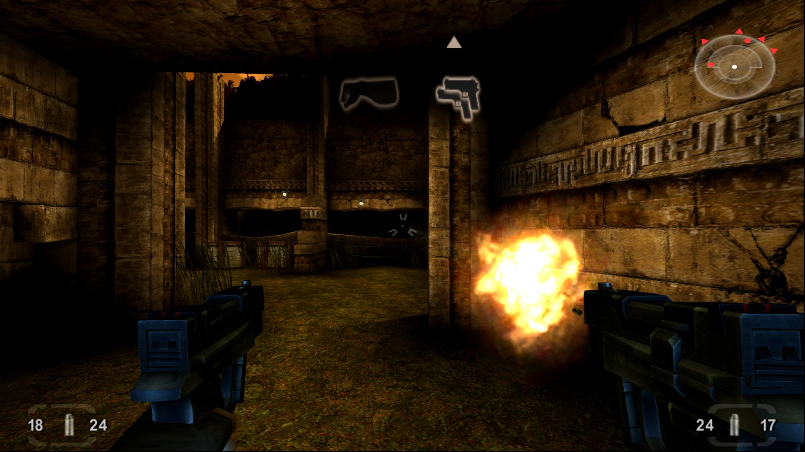
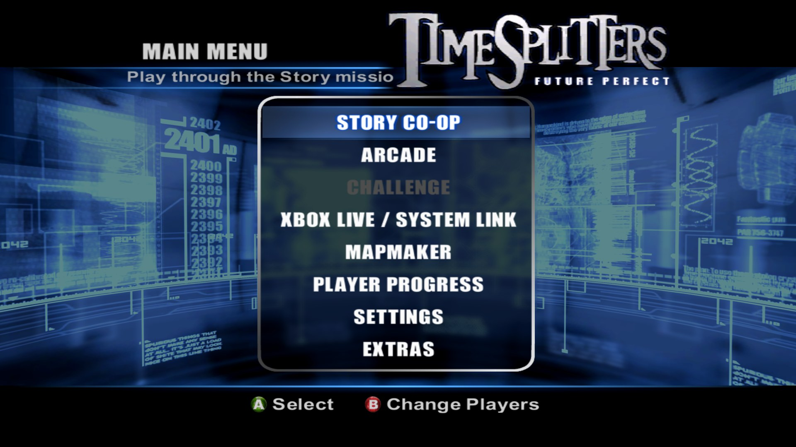
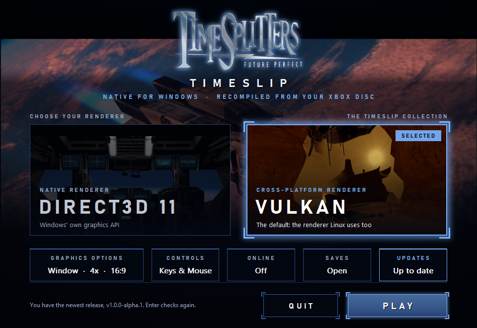

# TimeSplitters: Future Perfect (Timeslip collection)

The Timeslip collection's second game: TimeSplitters: Future Perfect (Xbox),
statically recompiled on the [Recompose](https://github.com/Joshspeakman/recompose)
toolkit, beside TimeSplitters 2 (the repository's root). It shares the toolkit
submodule, the tools and the launcher; everything that is about this game is
in this folder.

<p align="center">






</p>

Rendered at 5 times the console's resolution in the game's own widescreen,
captured from the game as it runs (the two recordings in `tests/lockstep`,
player 1's view).

<p align="center">

</p>

**Plays on Windows and the Mac** (Nov 2026), and between them: online co-op
and System Link tested live between a Windows PC and a Mac on the final
build (25 November 2026), with the settings below on both.

## Where it is (25 November 2026)

- **Plays.** The front end (1-4 players, profiles, storage, the main menu),
  story mode's first level -- 2401, Time To Split: its briefing, the whole
  in-engine intro cutscene and the level itself, the handgun in hand and the
  HUD up -- at 60 fps with no fault, on Windows (Vulkan) and the Mac (Metal).
  Its movies (XMV) play through FFmpeg on both.
- **System Link** hosts a match: Xbox Live / System Link > System Link >
  Start New Match, the lobby, team select, an Assault match in the VR arena.
- **Online co-op** (lockstep, as TimeSplitters 2's: `docs/multiplayer.md`):
  Story Co-op and two-player Arcade, the whole game run on both machines and
  only the controllers sent, each player with the whole screen. Tried live
  between this PC and a Mac (26 Nov 2026): online co-op and System Link both
  ways round. See "Online co-op" below.
- **Characters and the world drawn as on the console** (recompose f0d5643,
  26 Nov 2026): Future Perfect loads each draw's vertex program into the slot
  it has selected rather than selecting again, and every draw was running the
  one before's -- bots and the player's body as shards, walls dark, the
  radar's map and the hands missing. Compared with xemu (the same disc and
  BIOS), an Arcade match's spawn now matches it almost exactly. Its sun and
  lens flare show at a raised resolution too (recompose 1ac4a42), and its
  muzzle flashes are soft clouds of fire rather than stacks of fog-coloured
  squares (recompose 0a52b3a: with fog off the combiners' FOG reads zero).
  Five Arcade maps looked at in play (Vietnam, the Hotel, Venice, the jungle
  temple, the nightclub): whole characters, effects and lighting as xemu
  shows them; TimeSplitters 2's Arcade recording renders to the same pixels
  before and after. The picture sits where xemu's does, to a tenth of a
  pixel: Future Perfect draws everything through vertex programs, whose
  positions carry the console's half-pixel offset already, so the renderer
  adds none (`xbox_D3D8SetPixelOffset(0)` in `src/main.c`); with its default
  half pixel the picture sat a console pixel right of xemu's, a black strip
  down the left edge at 2x and over.
- **Widescreen**, the game's own 16:9 mode (Widescreen in the launcher's
  Graphics or the Esc menu's Display): its camera, front end, cutscenes and
  HUD laid out for 16:9 by the game itself, on the console's widescreen flag.
  Its 3D vertex programs copy positions it transformed itself, which the
  renderer took for 2D and squeezed back to a 4:3 band; `src/main.c` has it
  squeeze none of Future Perfect's 2D (`fp/CMakeLists.txt`).
- **Installs** on Windows and the Mac, with its own icon from the disc and
  the launcher's Updates tile (see "Building").
- **Native mouse look**, as TimeSplitters 2's: the mouse turns the player
  as an angle, added after the game's look step (`sub_0025D520`) to the
  look state's yaw and pitch ([0x007B0C7C] +0x100, +0x104, degrees; the
  pitch held within the game's limit at 0x007B0C80), for the controller the
  game maps that state to; the right stick is left to a pad. Online co-op
  latches each machine's mouse with its controller.
- **Keyboard and mouse** laid out over the game's own Default control layout
  (Settings > Controls): W A S D, the mouse to look, left button fire, right button aim, G
  grenade, R reload, V melee, F/E/Space activate, C/Ctrl crouch, Q change
  weapon, the middle button or Z toggle the weapon's mode (zoom in while
  aiming), X change grenades (zoom out), Enter or P pause, Tab the
  SCORES / OPTIONS screen (the Xbox's Back), T and B the White and Black
  buttons, I J K L the right stick, H and left Shift fire and aim. Every
  Xbox control has a key, so nothing any menu or mode asks for is out of
  reach. All of it in `src/title_defaults.c`; any of it rebound in the
  launcher. **The mouse** does what the screen needs (`fp_menu_mouse_frame`):
  on foot it looks; in the front end and every submenu, the pause and SCORES
  screens and results the pointer is shown and it works the menu (left
  button A, right B, the wheel up and down), as TimeSplitters 2's; in
  MapMaker it moves MapMaker's own cursor and its buttons choose; in a
  control mode off foot (vehicles, mounted guns) it moves the right stick,
  lifted past the game's 0.25 dead zone so a slow movement still moves. The
  **wheel** changes weapon, or zooms while aiming a weapon that zooms (the
  scoped pistol), as the d-pad does. The keyboard only counts while the
  game's window is in front (Windows read it whatever was in front: Enter
  typed in a chat paused the game). With mouse look
  on, the profile's **Auto Lookahead** is set aside while the game's look
  step runs (`sub_0025D520`; the profile itself is untouched), as
  TimeSplitters 2 does it: it levelled the view as you walked, so a look up
  or down with the mouse was pulled back to the horizon within a second
  (tried in 2401, before and after).
- **The launcher's art** from your disc (`tools/make_disc_art.py --title
  fp`): the logo, the ship over the planet, the cockpit, the canyon, the same
  frames on Windows and the Mac (the run is timed by frame under lockstep).
- **The number keys** 1 to 9 take your first, second, ... weapon, in the
  order the d-pad steps through them (fists, then the pistols, then what you
  pick up), as TimeSplitters 2's do. A weapon is counted once however many
  of its slots you hold (the pistol, its other mode and a pair are three
  slots of one weapon), one you have not got or cannot hold now is not
  counted, and the key of the weapon in hand does nothing. The game is asked
  as its own d-pad asks it (`fp_weapon_change` on `sub_001BF140`, the
  d-pad's weapon change: `sub_001BAA70` and `sub_001BA410` for each slot of
  the order at 0x004FC888, then the change itself, `sub_001BA130`), so a key
  lands where the d-pad would, with its sound and the HUD's weapon panel;
  online the key is latched with the controller. Tried in an Arcade match
  under lockstep: 1 fists, 2 the pair of pistols, 3 nothing (no third
  weapon); and with two more weapons given for the test, 3 and 4 took them
  and 4 again did nothing. The game has its own crosshair options
  (Settings > Controls > Crosshair).
- **Field of view**: the launcher's and the Esc menu's FOV setting replaces
  the game's 55 degrees (vertical) where the game asks for it
  (`sub_000CB3B0`), so what is drawn and what is culled widen together; 0,
  the default, is the game's own, and a narrower view the game makes is left
  alone. It holds from the spawn and in split screen too (the player's own
  copies of base_fov's test, `sub_000CC720` and `sub_000CBD10`; split
  screen's 45 widens in step). **The weapon in hand** stays the size and
  place the game's own angle gives it: the hands, the weapon
  (`sub_000A2740`, the objects in a player's first-person layer, 0xCA + the
  player) and the muzzle flash (`sub_00111FC0`, the effects drawn in camera
  space) are drawn tan(fov/2) / tan(55/2) times larger about the middle of
  that player's view (recompose `xbox_D3D8SetViewModelZoom`), so at 80 the
  world is wider and the pistols and their flash are where they were at 55,
  in one-player play and in each half of split screen. Aiming in, or any
  angle of the game's own, is left as the game draws it.
- **Frame interpolation** (the launcher's and the Esc menu's Frame
  interpolation, `frame_interp` 2 to 4), as TimeSplitters 2's: the frames
  between the game's own are its frame drawn again with each draw's
  transforms blended part of the way back. Future Perfect's objects and the
  weapon in hand go through a model-view (c64) and the projection (c60), as
  TS2's do; its level through one whole transform (c68), which recompose
  blends term by term (`xbox_D3D8SetInterpProjective`, `src/main.c`).
  Before, with only the default c60 named, every in-between frame was the
  newer frame to the pixel; now on a turn each sits between the two, and
  in split screen the halves keep their edge (an orange line of sky across
  the middle, gone; TimeSplitters 2's had one too).
- **Clears of some colour channels** as the console does them
  (`xbox_D3D8SetClearChannels(1)` in `src/main.c`; recompose
  `d3d8_xbox.h`, `RECOMP_CLEAR_CHANNELS=0/1` to override): the Audio/Video
  Options panel clears only its rectangle's alpha (D3DCLEAR flags 0x80) and is
  translucent over the front end, where a clear of all four channels painted
  it black.
- The **volume sliders** in Settings > Audio/Video Options (MUSIC VOLUME,
  SOUND VOLUME) are drawn and move, as xemu shows them (26 Nov 2026). The
  menu builder (`sub_002C3E20`) hands each volume row a draw callback,
  0x002C3500 on the front end, that the disassembler ran into the function
  before it, so it was never lifted: every call was an unresolved indirect
  call and the row drew nothing (about a thousand a minute on that screen).
  A seed (`config/us/seeds.json`) lifts it. Found by tracing the Controls
  screen's Turn Speed slider to the slider routine `sub_000814B0` and its
  callers (`RECOMP_HLE_D3D8_TRACE_DRAW_FRAME`).
- For Josh: TimeSplitters 2 clears some channels too, on its title and
  player-count screen, and with them honoured the blue swirl behind its logo
  comes out darker and more see-through in the middle. Which is right wants
  a look at the console or footage; if the darker one is, TimeSplitters 2
  turns the clears on as Future Perfect does.

A scripted path to the first level (fresh saves, a game copy without UDATA):

    RECOMP_INPUT_SEQ_PAD=1
    RECOMP_INPUT_SEQ=20000:a,26000:a,32000:a,38000:a,44000:a,50000:a,56000:a,62000:a

1 PLAYER, Create New Profile, Enter Name (A keeps "Player 1"), the Xbox Hard
Disk, Story, 2401 Time To Split, Normal, the briefing. To host System Link
instead: `20000:a,26000:a,32000:a,38000:a,43000:down,44000:down,45000:down,
47000:a,50000:down,51500:a,56000:a` (with `RECOMP_SYSLINK=host`), which
leaves the host in its lobby; A starts it.

## Online co-op

As TimeSplitters 2's (`docs/multiplayer.md`, "Online co-op"): both machines
run the whole game and send only the controllers, frame by frame (recompose
`docs/technical/lockstep.md`). In the launcher's System Link tab one player
chooses **Host online co-op** and the other **Join online co-op** with the
host's address; or `RECOMP_LOCKSTEP_NET=host` (UDP 27620) and
`RECOMP_LOCKSTEP_NET=join RECOMP_LOCKSTEP_PEER=<host>`. Then, as on one
console: **2 PLAYER**, each player makes or picks a profile (player 2 presses
START to join), **Story Co-op** (or Arcade). Both copies must be the same
build.

Each player has the whole screen, as in TimeSplitters 2's: the game lays
every player's camera out as the whole screen on both machines, and each
machine draws only its own player's pass (`coop_view = split` keeps the
console's split screen; both players must choose the same). A level's intro,
which both players watch through player 1's camera, is shown to both. The
cameras are laid out when a level is set up, by the camera layout switch
(USA `sub_0025A570`) through viewport_rect (`sub_00055D90`); each player's
pass points the current-viewport word (`0x007E71C8`) at that player's
camera's, and the renderer leaves out the other player's camera and HUD
(`fp_viewport_rect` in `src/recomp_manual.c`; `RECOMP_FP_VIEW_PORT=0|1`
shows a local game as that player would see it online). All but the frame's
one clear: the game clears the whole screen once, in player 1's pass, for
both players, and player 2's machine keeps it (recompose
`xbox_D3D8FilterAsksClear`); left out with player 1's draws, player 2's level
was drawn against the last frame's depth and only the sky and a few pieces
showed (found by the Mac session in a live game, 26 Nov 2026).

What it took (`src/recomp_manual.c`, `config/us/overrides.inc`):

- One step per frame: the frame clock (USA `sub_001538C0`) waits for the
  vblank count to move and steps by the vblanks since the last frame, 1 to 3;
  under lockstep the count (`sub_00022030`) answers the frame tick instead.
- The loading screen's own thread is never started in a session
  (`sub_00156D80`): it draws while the game loads, spinning on the vblank
  count, which no load moves under lockstep, so the game froze at its first
  load. In co-op a loading screen holds still.
- The state checked is `.data`, less the vblank count and five GPU fence
  times the game keeps there. Direct3D's fence time follows the host's
  timing -- the boot's movies play before the first frame on the host's
  clock, and Direct3D fences as its push buffer fills, as fast as the host's
  GPU thread empties it -- so those words differ between machines, though the
  game only hands them back to Direct3D's waits.

`tests/lockstep/` holds the checks (its README): Story Co-op in 2401, and a
2-player Arcade Deathmatch in Vietnam against six bots with a pause. Measured
26 November 2026 (Windows, Vulkan): four copies replaying the Arcade one at
once and three the Story one, each the same as its recording at every frame;
online between two copies on one PC (1 ms, 3 frames of delay), host and
joiner each the same as the recording at every frame and as each other at
every 60-frame check, through frame 14,400, with the Arcade one (and with the
first Story recording, before the fifth fence word). On the Mac (M1 Pro,
arm64, Metal, re-lifted at the same commits) the first Story recording
replayed the same at every frame. Live between this PC and the Mac (26 Nov
2026, 6 ms, 3 frames of delay): the Arcade one, both machines the same as the
recording at every frame and as each other at every check.

With each player's whole screen (online, `coop_view` own) the game is laid
out differently from the recordings, which were made split: the machines
agree with each other at every check, but not with the recording for a few
hundred frames after a level is set up (Story from 5,280, Arcade from
5,520). Replayed locally, or online with `coop_view = split`, they match the
recording at every frame.

| | |
| --- | --- |
| Title ID | `45410066` ("TimeSplitters FP") |
| Release | USA, version 1, built 2005-02-28; `default.xbe` SHA-1 `daf0bcc57b6e93a7ebf5498074c8a9e7dc90381e` |
| XDK | 5849, plain D3D8, with XONLINE, XNET, XMV (its movies) and DOLBY |
| Entry point | `0x0038024D` |
| Code | `.text` 3.9 MB, twice TimeSplitters 2's |

## Building

Put your own disc's files in `fp/game/` (`default.xbe`, `pak/`, `xmv/`; never
committed), then:

    py -3 fp/scripts/build.py              # lift (first time), then build
    py -3 fp/scripts/build.py --relift     # after seeds, overrides or the toolkit change

On Windows with the zig toolchain, `tools\build_windows.ps1 -Title fp -Vulkan`.
The executable is `fp/build/Release/timeslip_fp(.exe)`, with
`timeslip_fp_launcher` beside it: the collection's one launcher, the same as
TimeSplitters 2's (`../src/launcher_games.c`), which opens on both games and
finds TimeSplitters 2 in its install folder or build tree.

To install it as a program: `tools\install_windows.ps1 -Title fp` on Windows
(`%LOCALAPPDATA%\Programs\Timeslip Future Perfect`, Start menu and desktop
shortcuts named "TimeSplitters Future Perfect", an entry in Settings > Apps,
FFmpeg's three libraries beside the game for its movies, the launcher's art
made once from your disc by `tools/make_disc_art.py --title fp` and the icon
from it), or `mac/install.sh --title fp` on a Mac. The launcher's Updates tile
updates it from the collection's releases as it does TimeSplitters 2.

## Layout

```text
fp/CMakeLists.txt        the executable and the launcher, on top of ../recompose
fp/scripts/build.py      lift (first time or --relift), then configure and build
fp/src/main.c            the host entry point (TimeSplitters 2's, renamed)
fp/src/recomp_manual.c   the toolkit template's runtime glue; Future Perfect's hooks
fp/src/title_defaults.c  the keyboard, mouse and settings defaults
fp/config/us/            the USA release's addresses: seeds.json, xdk_symbols.json, overrides.inc
fp/game/                 the disc, supplied by you            (ignored)
fp/src/recomp/           the lifted code: game code            (ignored)
.pipeline/fp-us/         the pipeline's stage output           (ignored)
```

`config/us/seeds.json` starts from Recompose's runtime seeds for this title
(`recompose/config/seeds/45410066.json`) and `overrides.inc` carries the
toolkit project's one override (`titles/futureperfect`): the toolkit took the
game to its front end in September 2026 (recompose `CLAUDE.md`, "Update, 22 Sep
2026", and `docs/technical/shadow-mode.md`).
